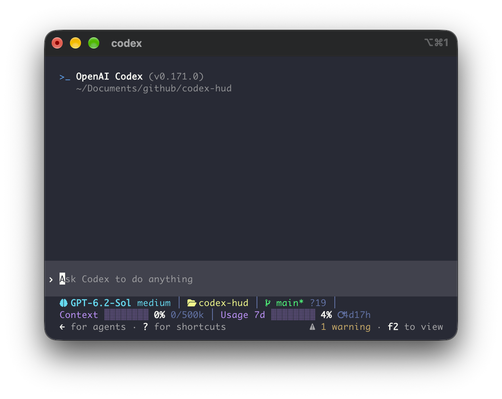

# codex-hud: Codex CLI Status-Line HUD

**English** | [简体中文](README_CN.md)

`codex-hud` is a compact status-line HUD for the Codex CLI, inspired by [claude-hud](https://github.com/jarrodwatts/claude-hud) and [agy-hud](https://github.com/franksde/agy-hud). It renders natively in the terminal TUI footer with zero runtime dependencies (Node.js 18+ only).



```text
gpt-5.5 high │ codex-hud │ ⎇ main* +1~2?1 ↑1 │ Context ███░░░░░ 43% 172k/400k │ Usage 5h ██░░░░░░ 23% ↻1h51m  7d ██████░░ ! 74% ↻3d5h
```

## Requirements

- **Codex CLI 0.171.0 or newer** with the experimental `tui_extensions_statusline` feature. Verified on `codex-cli 0.171.0`.
- **Node.js 18+**. The install script registers the absolute path of the `node` that runs it. The plugin runs `node` from the `PATH` Codex was started with (see [Node Is Not Found](#node-is-not-found)).
- **macOS, Linux, WSL, or Windows**. macOS / Linux / WSL can install as a Codex plugin or via the install script; Windows uses the install script.
- **A Nerd Font (optional)**. By default, `codex-hud` uses plain Unicode (`"icons": false`) and needs no special font at all. If you enable `"icons": true` without a Nerd Font configured in your terminal, icons render as boxes or `?` — see [Icons Render As Boxes](#icons-render-as-boxes).

`codex-hud` has zero third-party runtime dependencies, so no `npm install` is needed.

## Installation

There are two ways to install. Pick one: the install script refuses to run when the Codex plugin is already installed, and `--doctor` warns if both are present.

### Option 1: Codex Plugin (macOS / Linux / WSL)

This repository is also a Codex plugin marketplace (`.agents/plugins/marketplace.json`, `.codex-plugin/plugin.json`, `.mcp.json`), similar to how `claude-hud` ships as a Claude Code plugin:

```sh
codex plugin marketplace add zhshj0110/codex-hud   # or a local clone: codex plugin marketplace add ~/codex-hud
codex plugin add codex-hud@codex-hud
codex features enable tui_extensions_statusline
```

**Important: After installation, start Codex and select the provider once inside the TUI:**

```text
/statusline → Choose a status line provider → codex-hud · codex-hud@codex-hud
```

A plugin cannot enable the experimental feature or select itself as the active status-line provider, so those two steps are manual (similar to `agy-hud`'s one-time `/statusline` command).

- The plugin starts the server with `node ./hud.mjs` from the plugin directory, so `node` (18+) must be on the `PATH` Codex was started with. That is usually true when you start Codex from a shell where `node` works; otherwise use Option 2.
- Because Codex starts MCP servers with a minimal environment, `.mcp.json` explicitly forwards `HOME`, `PATH`, `CODEX_HOME`, `XDG_CONFIG_HOME`, and the `CODEX_HUD_*` variables.
- **Windows:** the plugin has not been tested on Windows; use Option 2 (the install script).

### Option 2: Install Script (All Platforms, Including Windows)

```sh
git clone https://github.com/zhshj0110/codex-hud.git ~/codex-hud
node ~/codex-hud/install.mjs
```

On Windows (PowerShell or `cmd.exe`):

```powershell
git clone https://github.com/zhshj0110/codex-hud.git "$HOME\codex-hud"
node "$HOME\codex-hud\install.mjs"
```

The installer backs up `config.toml` to `config.toml.before-codex-hud.<timestamp>`, then performs three steps:

1. Runs `codex features enable tui_extensions_statusline`.
2. Registers the `codex-hud` MCP server as `<node> <clone>/hud.mjs`, where `<node>` is the absolute path of the Node.js running the script, so Codex's minimal `PATH` does not need to contain `node`. To register a different Node, run the script with it, e.g. `/opt/homebrew/bin/node ~/codex-hud/install.mjs`.
3. Writes `status_line_provider = { server = "codex-hud", tool = "statusline" }` under `[tui]`. Pass `--no-select` if you prefer to choose it manually in `/statusline`.

Config edits use an atomic temp-file + `rename` write that preserves file permissions, and the installer verifies the result with `codex features list`. If an installation or removal step fails after editing `config.toml`, the backup is restored (or a newly created `config.toml` is removed). If `[tui]` uses an unsupported layout (`[tui.status_line_provider]` subtable, top-level `tui.xxx =` dotted keys, or a multi-line `status_line_provider`), the installer aborts before modifying anything and suggests `--no-select`.

Start a new Codex session to see the HUD.

## Upgrading

- **Codex plugin (Git marketplace):**

  ```sh
  codex plugin marketplace upgrade codex-hud
  codex plugin add codex-hud@codex-hud
  ```

- **Install script (local clone):**

  ```sh
  cd ~/codex-hud && git pull
  ```

  Because the registered MCP server runs `hud.mjs` from your clone, pulling updates takes effect on your next Codex session with no need to rerun `install.mjs`. Rerun it only if you changed environment variables such as `CODEX_HOME`, or removed the Node version it registered.

Your user config lives outside the repository at `~/.config/codex-hud/config.json`, so upgrading or reinstalling never overwrites it.

## Uninstalling

- **Codex plugin:**

  ```sh
  codex plugin remove codex-hud@codex-hud
  codex plugin marketplace remove codex-hud   # optional
  ```

  Then switch back in Codex: `/statusline → Choose a status line provider → Default status line`.

- **Install script:**

  ```sh
  node ~/codex-hud/install.mjs --uninstall
  ```

  This removes both the `codex-hud` MCP server entry and the `[tui] status_line_provider` selection from `config.toml`.

- **Temporarily hiding the footer (keeping your provider selection):**
  - Plugin users: set `CODEX_HUD_DISABLE=1` before launching Codex.
  - Install-script users: run `CODEX_HUD_DISABLE=1 node ~/codex-hud/install.mjs --no-select`, then restart Codex.
  - To re-enable, unset `CODEX_HUD_DISABLE` (and rerun `install.mjs --no-select` if you used the install script).

## Icons Render As Boxes

By default, `codex-hud` uses plain Unicode (`"icons": false`), so it works in any terminal without installing a special font.

When `"icons": true` is enabled, `codex-hud` uses Nerd Font Private Use Area glyphs for `model`, `folder`, `branch`, `mode`, `tools`, `plan`, `edit`, `clock`, `reset`, and `fast`. A terminal font without those glyphs renders them as boxes or `?`.

Run the built-in diagnostic check:

```sh
node hud.mjs --doctor
```

It prints a side-by-side **Plain Unicode vs. Nerd Font probe**. **Read the probe line yourself** — a terminal never reports which glyphs it actually drew, so only looking at the probe in your own terminal tells you whether Nerd Font icons work.

If the `nerd` row shows boxes, `?`, or blanks, pick one:

**A. Use plain Unicode (default).** Works everywhere, takes effect within 5 seconds, needs no font:

```sh
mkdir -p ~/.config/codex-hud
echo '{"icons": false}' > ~/.config/codex-hud/config.json   # merge the key if the file already exists
```

On Windows, in PowerShell (`mkdir -p` does not exist in `cmd.exe`, and Windows PowerShell 5.1 writes UTF-16 through `>`, which JSON parsing will reject):

```powershell
New-Item -ItemType Directory -Force -Path "~\.config\codex-hud" | Out-Null
Set-Content -Encoding ascii -Path "~\.config\codex-hud\config.json" -Value '{"icons": false}'
```

**B. Enable Nerd Font icons.** Two steps, and only the second changes what appears on screen:

1. Install a Nerd Font — for example `brew install --cask font-hack-nerd-font` on macOS, or Hack Nerd Font from <https://www.nerdfonts.com> on Windows.
2. Point your terminal profile at that font family (e.g., iTerm2 → Settings → Profiles → Text → Font, VS Code `terminal.integrated.fontFamily`, `font-family` in `~/.config/ghostty/config`, or Windows Terminal → Settings → Profiles → Defaults → Appearance → Font face). Note that Ghostty, WezTerm, and kitty ship built-in Nerd Font symbol fallbacks.

Over SSH, glyphs are rendered by the terminal on your **local** machine, so installing a font on the remote host changes nothing. Use option B locally, or keep `"icons": false` on the remote host.

## Node Is Not Found

Codex starts MCP servers with a minimal environment (`HOME` and `PATH`, without loading `.zshrc` or `.bashrc`). How that affects `codex-hud` depends on how you installed it.

**Install script.** The server is registered with the absolute path of the `node` that ran `install.mjs`, so `PATH` does not matter. If that `node` came from a version manager (nvm, fnm, Volta, mise, asdf, nodenv, or n), the path points inside one specific Node version, and removing that version breaks the footer. Either rerun `install.mjs` with the Node you switched to, or register a Node outside any version manager once:

```sh
/opt/homebrew/bin/node ~/codex-hud/install.mjs   # or /usr/local/bin/node, /usr/bin/node, ...
```

`node hud.mjs --doctor` warns when the registered Node belongs to a version manager or no longer exists.

**Codex plugin.** The plugin runs `node ./hud.mjs`, so `node` must be on the `PATH` Codex was started with. If you start Codex somewhere `node` is not on `PATH`, the server fails to start (press `F2` in Codex to see the error). Use the install script in that case.

Check what is registered:

```sh
codex mcp get codex-hud
```

## For AI Agents

If you are an AI agent installing or troubleshooting `codex-hud` for a user, do not install blindly and do not assume Nerd Font icons work on their terminal.

**1. Check existing state first.** Run `node hud.mjs --doctor --json` (if the repo is already present) or check `~/.codex/config.toml` and `codex plugin list`. Do not install the script while the Codex plugin is installed (or vice versa) — `install.mjs` refuses when the plugin is present, and having both causes a warning.

**2. Preview and confirm preferences.** Show the user what the default footer looks like:

```text
gpt-5.5 high │ codex-hud │ ⎇ main* +1~2?1 ↑1 │ Context ███░░░░░ 43% 172k/400k │ Usage 5h ██░░░░░░ 23% ↻1h51m  7d ██████░░ ! 74% ↻3d5h
```

Ask whether they want to customize `segments` (default: `model`, `project`, `context`, `limits`, `cost`; opt-in: `mode`, `title`, `tokens`, `env`, `tools`, `session`, `state`) or enable Nerd Font `"icons": true`.

- **Default is `"icons": false`**, which works everywhere without a Nerd Font.
- If they want `"icons": true`, send the Nerd Font probe from `doctor` (or have them run `node hud.mjs --doctor` in the terminal where they run Codex) and wait for their confirmation. **Never install a font unless they explicitly ask for it** — installing a font alone does not change the terminal's configured font family, and does nothing over SSH.

**3. Install.**
- macOS / Linux / WSL: prefer either the Codex plugin (`codex plugin marketplace add zhshj0110/codex-hud && codex plugin add codex-hud@codex-hud && codex features enable tui_extensions_statusline`, then instruct the user to select it in `/statusline`) or `node install.mjs` (which also enables the feature and writes `[tui] status_line_provider`).
- Windows: use `node install.mjs`.
- If `install.mjs` aborts due to an unsupported `[tui]` layout, show the error to the user and use `node install.mjs --no-select`, then instruct them to select `codex-hud` in `/statusline`.

**4. Verify with `node hud.mjs --doctor --json`.** Example output shape:

```json
{
  "version": "0.1.0",
  "ok": true,
  "counts": { "ok": 7, "warn": 0, "fail": 0 },
  "checks": [
    { "id": "node", "title": "Node.js", "status": "ok", "summary": "v22.14.0 (...)" },
    { "id": "codex", "title": "Codex CLI", "status": "ok", "summary": "codex-cli 0.171.0 (...)" },
    { "id": "feature", "title": "Statusline feature", "status": "ok", "summary": "tui_extensions_statusline (experimental) enabled" },
    { "id": "mcp", "title": "MCP server", "status": "ok", "summary": ".../bin/node .../codex-hud/hud.mjs" },
    { "id": "provider", "title": "[tui] provider", "status": "ok", "summary": "status_line_provider = { server = \"codex-hud\", tool = \"statusline\" }" },
    { "id": "config", "title": "User config", "status": "ok", "summary": "~/.config/codex-hud/config.json (default) is valid" },
    { "id": "render", "title": "Render limits", "status": "ok", "summary": "sample: ...; worst case: ..." }
  ],
  "icons": { "enabled": false, "plain": "...", "nerd": "..." },
  "preview": { "line": "...", "limits": { "ok": true } }
}
```

Act on each check:
- `node` (`fail`): Node.js is older than 18; report it.
- `codex` / `feature` (`fail` / `warn`): Codex CLI is missing, predates `tui_extensions_statusline`, or the feature is disabled (`codex features enable tui_extensions_statusline`).
- `mcp` (`warn`): server is missing, disabled, registered twice (both plugin and `config.toml`), points at a file that no longer exists, or uses a version-manager Node. Follow the check's `hint`.
- `provider` (`warn`): `[tui] status_line_provider` is unset or points to another provider. If another provider is selected, tell the user before changing it; for plugin installs, remind the user to pick `codex-hud` in `/statusline`.
- `config` (`warn`): invalid JSON, oversized (> 64 KiB), or unknown/mistyped keys. Merge fixes carefully rather than overwriting user settings.
- `disabled` (`warn`): `CODEX_HUD_DISABLE=1` is set in this environment, so the footer would be empty. Ask the user whether that is intended before unsetting it.
- `render` (`fail`): UI tree exceeded Codex's protocol limits.

## CLI

```sh
node install.mjs --dry-run                          # Preview config.toml changes without modifying anything
node install.mjs --no-select                        # Register MCP server without editing [tui] status_line_provider
node install.mjs --uninstall                        # Remove MCP server registration and provider selection

node hud.mjs --version                              # Print codex-hud version
node hud.mjs --preview                              # Render a sample snapshot in the terminal (or: npm run preview)
node hud.mjs --preview --theme dracula              # Preview with a specific theme (e.g. dracula, one-half-light)
node hud.mjs --preview --state snapshot.json --json # Render a custom snapshot and print the UI tree JSON
node hud.mjs --doctor                               # Run full diagnostics + icon probe (or: npm run doctor)
node hud.mjs --doctor --json                        # Machine-readable JSON diagnostics
```

`--doctor` makes no changes on disk. It checks Node.js (>= 18), Codex CLI version and `tui_extensions_statusline` status, MCP server registration and `[tui] status_line_provider`, user config validity, the Plain Unicode vs. Nerd Font icon probe, and both sample and worst-case stress renders against Codex's UI tree limits.

## How It Works

Unlike `claude-hud` and `agy-hud` — which run a host `statusLine` shell command that reads JSON from stdin and prints a line to stdout — Codex CLI exposes an experimental `tui_extensions_statusline` feature (introduced in 0.171) where **an MCP server acts as the status-line provider**:

1. The provider is a stdio MCP server that advertises a tool in `tools/list` with
   `_meta["openai/ui"].entrypoints = [{ type: "statusline", resourceUri: "ui://codex-hud/footer" }]`.
2. Once selected via `/statusline → Choose a status line provider` (saved under `[tui]` as `status_line_provider` in `config.toml`), Codex polls `resources/read` on that URI roughly once per second, passing a snapshot of the active thread in `params._meta["com.openai/codex-statusline-state"]`: model, reasoning effort, permissions & approval mode, thread title, cwd, context usage, cumulative tokens & cache hit rate, rate limits, cost, agent state, and more.
3. The provider returns a JSON UI tree (`row`, `text`, `bold`, `link`, etc., with `status-*` theme colors) that Codex renders natively. Protocol limits: 64 KiB JSON, 256 nodes, depth 16, 16 KiB text, and a 1-second timeout per read. Errors or timeouts stop polling until you re-select the provider in `/statusline`.

This protocol is documented in the built-in `create-statusline` skill inside the Codex binary. On top of the snapshot, `codex-hud` reads these local data sources:

| Segment | Source |
| --- | --- |
| `model` / `mode` (permissions, approval, profile) / `title` (optional) / `context` / `tokens` (input/output & cache rate) / `limits` (5h & 7d) / `cost` / `state` | Snapshot (`com.openai/codex-statusline-state`) |
| `project` (directory name + git branch, dirty, staged/modified/untracked counts, ahead/behind) | `git status --porcelain --branch`, cached for 2 s with background refresh |
| `env` (`AGENTS.md`, MCP server, and skill counts) | Scans `cwd` and `~/.codex` config/directories, cached for 30 s with background refresh |
| `tools` (plan progress & current step, running `◐` vs completed `⚙` tools, last command), `session` (elapsed duration, turns `#N`, patched files `✎ N`) & turn duration in `state` | Incremental reader on `~/.codex/sessions/**/rollout-*-<thread-id>.jsonl` |
| `context` window size when the snapshot lacks it | `~/.codex/models_cache.json`, cached for 60 s |
| `limits` when the snapshot carries no rate limits | Last 128 KiB of up to 30 of the newest rollout files under `~/.codex/sessions/` (any thread), cached for 30 s |

## Config

`codex-hud` resolves its configuration file in order:

1. `CODEX_HUD_CONFIG`
2. `$XDG_CONFIG_HOME/codex-hud/config.json`
3. `~/.config/codex-hud/config.json`

Changes take effect within 5 seconds with no restart required (see [`config.example.json`](./config.example.json)).

Default config:

```json
{
  "segments": ["model", "project", "context", "limits", "cost"],
  "barWidth": 8,
  "icons": false,
  "allLimits": false,
  "showGitCounts": true,
  "showCacheRate": true,
  "showLastCommand": true,
  "showPlanCurrent": true,
  "maxTools": 3,
  "lastCommandWidth": 32,
  "planCurrentWidth": 24,
  "titleWidth": 32,
  "warn": 70,
  "danger": 90
}
```

Options:

- `segments`: Ordered list of segments to display; omit any segment to hide it. Available segments: `model`, `mode`, `title`, `project`, `context`, `tokens`, `limits`, `cost`, `env`, `tools`, `session`, `state`. `mode`, `title`, `tokens`, `env`, `tools`, `session`, and `state` are off by default — add them to `segments` to enable them.
- `barWidth`: Progress bar width (1–40, default `8`).
- `icons`: Use Nerd Font glyphs instead of plain Unicode (default `false`).
- `allLimits`: Show all rate-limit buckets instead of only the primary `codex` bucket (default `false`).
- `showGitCounts`: Show staged (`+`), modified (`~`), and untracked (`?`) file counts next to the git branch (default `true`).
- `showCacheRate`: Show prompt cache hit percentage in the `tokens` segment (default `true`).
- `showLastCommand` / `lastCommandWidth`: Show the last shell command of the current turn at the end of `tools` and its max width (4–200, default `true` / `32`).
- `showPlanCurrent` / `planCurrentWidth`: When `update_plan` progress exists, show the current `in_progress` step next to `☑ done/total` and its max width (4–200, default `true` / `24`).
- `titleWidth`: Max character width for the `title` segment (4–200, default `32`); newlines and control characters are stripped.
- `maxTools`: Max distinct tools shown for running (`◐`) and completed (`⚙`) groups respectively (1–10, default `3`).
- `warn` / `danger`: Percentage thresholds for yellow (`!`) and red (`!!`) meter alerts (default `70` / `90`).

Invalid field types are ignored and fall back to defaults; numeric options are clamped to safe ranges so a typo in `config.json` will never break the footer.

## Colors & Themes

The footer follows Codex's active `/theme` as closely as possible (based on captured output from real Codex 0.171 TUI themes):

- Normal state uses only `status-*` theme colors and the default foreground, so switching `/theme` updates the footer automatically.
- Meters use their segment theme color (`status-usage` / `status-limit`) for the label and bar, with a bold default-foreground percentage:
  - At `warn`: the bar turns ANSI yellow and `!` is prefixed to the percentage.
  - At `danger`: the bar turns ANSI red and `!!` is prefixed to the percentage.
  - Alert colors use the terminal ANSI palette rather than theme colors. Markers (`!`/`!!`) are included because some themes use amber/reddish colors even in normal state (e.g. `status-limit` in `one-half-light`).
  - Thresholds are evaluated against the rounded displayed integer (e.g. `69.6%` renders as `! 70%`).
  - To disable alerts entirely, set both `warn` and `danger` to `101`.
- Because `waiting` and `working` share the same color in tested themes, `waiting` uses `◌` while `working` uses `●`.
- `surface` (theme background color, invisible text) and `accent` (emits no color) are intentionally avoided.
- The "Use theme colors" toggle in `/statusline` does not affect custom providers.

Preview different themes locally: `node hud.mjs --preview --theme dracula` or `--theme one-half-light`.

## Privacy And Security

`codex-hud` runs locally as a child stdio MCP server spawned by Codex CLI. It has **zero third-party runtime dependencies** and makes **no network requests**.

- `hud.mjs` is read-only: it reads JSON-RPC requests from `stdin`, local config (`<= 64 KiB`), git status via `execFile` (no shell interpolation, 800 ms timeout), bounded tails of the active thread's rollout file under `~/.codex/sessions/`, `~/.codex/models_cache.json`, and, for the rate-limit fallback, the last 128 KiB of up to 30 recent rollout files from any thread.
- Control characters and Unicode bidirectional overrides are stripped from untrusted strings (thread titles, plan steps, shell commands) before rendering.
- `node hud.mjs --doctor` only reads local files and runs read-only `codex` subcommands (`--version`, `features list`, `mcp get`, `plugin list`). Note that `--doctor --json` includes absolute local paths — review before pasting into public issues.
- See [SECURITY.md](./SECURITY.md) for the full security model and vulnerability reporting instructions.

## Development

```sh
npm test
npm run preview
npm run doctor
```

No build step is required. See [CONTRIBUTING.md](./CONTRIBUTING.md) for development workflow and testing guidelines. Licensed under the [MIT License](./LICENSE).

## Limitations

- `tui_extensions_statusline` is still experimental and its protocol may change across Codex versions. Verified on `codex-cli 0.171.0`.
- The footer is single-row (wrapping by segment when narrow). Multi-line dashboards like `claude-hud` are not supported by the protocol.
- For Codex to discover the provider, the `statusline` MCP tool must remain visible to the model: hiding it via `disabled_tools` causes `"Status line unavailable"`. Calling it has no side effects. Codex App and IDE extensions share the same `config.toml` and will start this server, though only the CLI TUI renders it.
- Codex passes a minimal environment to MCP servers. `install.mjs` stores the values of `CODEX_HOME`, `CODEX_HUD_CONFIG`, `XDG_CONFIG_HOME`, and `CODEX_HUD_DISABLE` if set when you run it. Rerun the script after changing those values, then restart Codex.
- If the footer falls back to the built-in one, press `F2` in Codex to see the error or run `node hud.mjs --doctor`.
- Every render is validated against Codex's limits (64 KiB JSON / 256 nodes / depth 16 / 16 KiB text): if exceeded, it falls back to `model` + `context`, and then to an empty footer so Codex does not stop polling.
- When first attaching to a large rollout file, only the last 2 MiB are read, at most 4 MiB are processed per poll, and single records over 1 MiB are skipped. In very long sessions, plan progress may wait until the next `update_plan` call.
