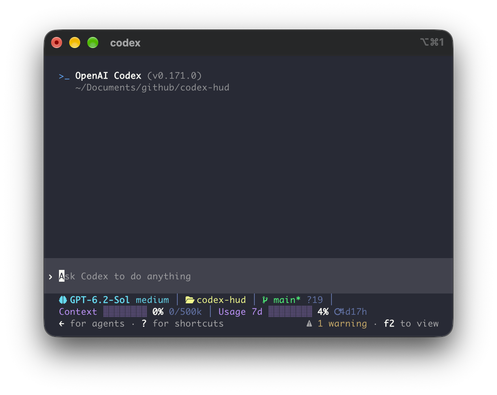

# codex-hud: Codex CLI 状态栏 HUD

[English](README.md) | **简体中文**

`codex-hud` 是一个给 Codex CLI 使用的紧凑型状态栏 HUD，思路参考 [claude-hud](https://github.com/jarrodwatts/claude-hud) 和 [agy-hud](https://github.com/franksde/agy-hud)。它在终端 TUI 的 footer 里原生渲染，零第三方运行依赖，只需要 Node.js 18+。



```text
gpt-5.5 high │ codex-hud │ ⎇ main* +1~2?1 ↑1 │ Context ███░░░░░ 43% 172k/400k │ Usage 5h ██░░░░░░ 23% ↻1h51m  7d ██████░░ ! 74% ↻3d5h
```

## 运行要求

- **Codex CLI 0.171.0 或更高版本**，并支持实验特性 `tui_extensions_statusline`。已在 `codex-cli 0.171.0` 上验证。
- **Node.js 18+**。安装脚本会注册运行它的那个 `node` 的绝对路径；插件则使用 Codex 启动时 `PATH` 上的 `node`（见[找不到 Node](#找不到-node)）。
- **macOS、Linux、WSL 或 Windows**。macOS / Linux / WSL 支持以 Codex 插件或安装脚本安装；Windows 请使用安装脚本。
- **Nerd Font 字体（可选）**。默认关闭 Nerd Font 图标（`"icons": false`），使用标准 Unicode 字符，不依赖任何字体即可正常显示。如果你开启了 `"icons": true` 但终端没有配置 Nerd Font，图标会显示成方块或 `?`——详见[图标显示成方块](#图标显示成方块)。

`codex-hud` 零第三方运行依赖，无需执行 `npm install`。

## 安装

提供两种安装方式，二选一即可。如果 Codex 插件已经安装，安装脚本会拒绝执行；两种方式同时存在时，`--doctor` 会给出警告。

### 方式一：Codex 插件（macOS / Linux / WSL）

本仓库本身就是一个 Codex 插件 marketplace（`.agents/plugins/marketplace.json`、`.codex-plugin/plugin.json`、`.mcp.json`），与 `claude-hud` 作为 Claude Code 插件发布类似：

```sh
codex plugin marketplace add zhshj0110/codex-hud   # 或本地 clone：codex plugin marketplace add ~/codex-hud
codex plugin add codex-hud@codex-hud
codex features enable tui_extensions_statusline
```

**重要：安装完成后，请启动 Codex 并在 TUI 中手动选中一次 provider：**

```text
/statusline → Choose a status line provider → codex-hud · codex-hud@codex-hud
```

插件无法自行开启实验特性，也无法把自己设成当前状态栏 provider，因此这两步需要手动执行一次（类似 `agy-hud` 安装后需要运行一次 `/statusline`）。

- 插件在插件目录下以 `node ./hud.mjs` 启动 server，因此 Codex 启动时的 `PATH` 上必须有 `node`（18+）。从能正常运行 `node` 的 shell 里启动 Codex 时通常没问题，否则请使用方式二。
- Codex 启动 MCP server 时只传递极少数环境变量，因此 `.mcp.json` 会显式透传 `HOME`、`PATH`、`CODEX_HOME`、`XDG_CONFIG_HOME` 以及 `CODEX_HUD_*` 变量。
- **Windows：** 插件方式尚未在 Windows 上测试，请使用方式二（安装脚本）。

### 方式二：安装脚本（全平台，含 Windows）

```sh
git clone https://github.com/zhshj0110/codex-hud.git ~/codex-hud
node ~/codex-hud/install.mjs
```

Windows（PowerShell 或 `cmd.exe`）：

```powershell
git clone https://github.com/zhshj0110/codex-hud.git "$HOME\codex-hud"
node "$HOME\codex-hud\install.mjs"
```

安装脚本会先把 `config.toml` 备份为 `config.toml.before-codex-hud.<时间>`，然后完成三步：

1. 执行 `codex features enable tui_extensions_statusline`。
2. 注册 `codex-hud` MCP server，命令为 `<node> <仓库>/hud.mjs`，其中 `<node>` 是运行安装脚本的 Node.js 的绝对路径，因此 Codex 的精简 `PATH` 里不需要有 `node`。如需注册另一个 Node，用它来运行脚本即可，例如 `/opt/homebrew/bin/node ~/codex-hud/install.mjs`。
3. 在 `[tui]` 下写入 `status_line_provider = { server = "codex-hud", tool = "statusline" }`。如果希望之后自己在 `/statusline` 里选择，可加 `--no-select`。

配置写入采用同目录临时文件加原子 `rename`，保留原文件权限，并用 `codex features list` 校验结果。若修改配置后的步骤失败，脚本会自动从备份恢复（或清理本次新建的配置）。如果 `[tui]` 使用了不支持的写法（`[tui.status_line_provider]` 子表、顶层 `tui.xxx =` 点号键、多行的 `status_line_provider`），脚本会在改动任何文件前中止，并提示改用 `--no-select`。

装好后重开一个 Codex 会话即可看到状态栏。

## 升级

- **Codex 插件（Git marketplace）：**

  ```sh
  codex plugin marketplace upgrade codex-hud
  codex plugin add codex-hud@codex-hud
  ```

- **安装脚本（本地 clone）：**

  ```sh
  cd ~/codex-hud && git pull
  ```

  注册的 MCP server 直接运行本地仓库中的 `hud.mjs`，拉取更新后重开 Codex 会话即可生效，无需重跑 `install.mjs`。只有在修改了 `CODEX_HOME` 等环境变量，或卸载了注册时使用的 Node 版本后，才需要重跑。

用户配置文件独立存放在 `~/.config/codex-hud/config.json`，升级或重装都不会覆盖它。

## 卸载

- **Codex 插件：**

  ```sh
  codex plugin remove codex-hud@codex-hud
  codex plugin marketplace remove codex-hud   # 可选
  ```

  然后在 Codex 中切回内置状态栏：`/statusline → Choose a status line provider → Default status line`。

- **安装脚本：**

  ```sh
  node ~/codex-hud/install.mjs --uninstall
  ```

  该命令会一并移除 `config.toml` 中的 `codex-hud` MCP server 注册和 `[tui] status_line_provider` 选择。

- **临时隐藏状态栏（保留 provider 选择）：**
  - 插件用户：启动 Codex 前设置 `CODEX_HUD_DISABLE=1`。
  - 脚本安装用户：运行 `CODEX_HUD_DISABLE=1 node ~/codex-hud/install.mjs --no-select`，然后重启 Codex。
  - 恢复显示时取消 `CODEX_HUD_DISABLE`（脚本安装用户再运行一次 `install.mjs --no-select`）。

## 图标显示成方块

`codex-hud` 默认使用纯 Unicode 字符（`"icons": false`），在任何终端下都无需安装特殊字体。

开启 `"icons": true` 后，状态栏会为 `model`、`folder`、`branch`、`mode`、`tools`、`plan`、`edit`、`clock`、`reset` 和 `fast` 使用 Nerd Font 私有区字形。如果终端字体不包含这些字形，它们就会显示成方块或 `?`。

运行内置诊断：

```sh
node hud.mjs --doctor
```

它会打印一行 **Plain Unicode 与 Nerd Font 对比探针**。**请直接在你运行 Codex 的终端里肉眼查看这行探针**——终端不会回传自己实际画出了什么字形，没有任何程序能替你判断屏幕上看到的是图标还是方块。

如果 `nerd` 行显示方块、`?` 或空白，二选一：

**A. 保持或切回纯 Unicode（默认）。** 到处可用，5 秒内自动生效，不需要任何字体：

```sh
mkdir -p ~/.config/codex-hud
echo '{"icons": false}' > ~/.config/codex-hud/config.json   # 文件已存在时请将该键合并进去
```

Windows 请使用 PowerShell（`cmd.exe` 没有 `mkdir -p`，而 Windows PowerShell 5.1 的 `>` 会写入 UTF-16，导致 JSON 解析失败）：

```powershell
New-Item -ItemType Directory -Force -Path "~\.config\codex-hud" | Out-Null
Set-Content -Encoding ascii -Path "~\.config\codex-hud\config.json" -Value '{"icons": false}'
```

**B. 使用 Nerd Font 图标。** 需要两步，且只有第二步会改变屏幕上的显示：

1. 安装 Nerd Font，例如 macOS 上运行 `brew install --cask font-hack-nerd-font`，Windows 上从 <https://www.nerdfonts.com> 下载 Hack Nerd Font。
2. 把终端 profile 的字体指向该字族（如 iTerm2 → Settings → Profiles → Text → Font、VS Code 的 `terminal.integrated.fontFamily`、`~/.config/ghostty/config` 中的 `font-family`、Windows Terminal → Settings → Profiles → Defaults → Appearance → Font face）。Ghostty、WezTerm、kitty 自带 Nerd Font 符号回退，通常开箱即可显示。

在 SSH 会话里，字形由你**本地**机器上的终端绘制，在远端主机装字体不起任何作用。请在本地按方案 B 配置，或在远端保持 `"icons": false`。

## 找不到 Node

Codex 启动 MCP server 时只传递精简环境（`HOME` 和 `PATH`，通常不加载 `.zshrc` / `.bashrc`）。具体影响取决于安装方式。

**安装脚本。** server 注册的是运行 `install.mjs` 的 `node` 的绝对路径，与 `PATH` 无关。但如果这个 `node` 来自版本管理器（nvm、fnm、Volta、mise、asdf、nodenv 或 n），路径会指向某个具体的 Node 版本目录，卸载该版本后状态栏就会失效。可以在切换版本后用新的 Node 重跑 `install.mjs`，或者一次性注册一个不属于任何版本管理器的 Node：

```sh
/opt/homebrew/bin/node ~/codex-hud/install.mjs   # 或 /usr/local/bin/node、/usr/bin/node 等
```

当注册的 Node 属于版本管理器或已不存在时，`node hud.mjs --doctor` 会给出警告。

**Codex 插件。** 插件运行 `node ./hud.mjs`，因此 Codex 启动时的 `PATH` 上必须有 `node`。如果 Codex 是在 `PATH` 里没有 `node` 的环境中启动的，server 会启动失败（在 Codex 中按 `F2` 可查看错误），这种情况请改用安装脚本。

查看当前注册的命令：

```sh
codex mcp get codex-hud
```

## 面向 AI Agent

如果你是正在替用户安装或排查 `codex-hud` 的 AI agent，请不要静默安装，也不要默认用户的终端一定支持 Nerd Font 图标。

**1. 先检查现状。** 如果仓库已在本地，先运行 `node hud.mjs --doctor --json`，或检查 `~/.codex/config.toml` 与 `codex plugin list`。不要在已安装插件时再跑 `install.mjs`（反之亦然）——插件存在时 `install.mjs` 会拒绝执行，两者并存也会触发 `--doctor` 警告。

**2. 展示预览并确认偏好。** 先向用户展示默认状态栏的样子：

```text
gpt-5.5 high │ codex-hud │ ⎇ main* +1~2?1 ↑1 │ Context ███░░░░░ 43% 172k/400k │ Usage 5h ██░░░░░░ 23% ↻1h51m  7d ██████░░ ! 74% ↻3d5h
```

询问用户是否要调整 `segments`（默认 `model`、`project`、`context`、`limits`、`cost`；可选开启 `mode`、`title`、`tokens`、`env`、`tools`、`session`、`state`），或开启 Nerd Font `"icons": true`。

- **默认为 `"icons": false`**，无需任何特殊字体即可开箱使用。
- 如果用户想要 `"icons": true`，请展示 `doctor` 的 Nerd Font 探针（或让用户在实际运行 Codex 的终端中执行 `node hud.mjs --doctor`）并等待确认。**除非用户主动要求，否则不要替用户安装字体**——单装字体不会修改终端的字体配置，且在 SSH 下完全无效。

**3. 执行安装。**
- macOS / Linux / WSL：可选用 Codex 插件（`codex plugin marketplace add zhshj0110/codex-hud && codex plugin add codex-hud@codex-hud && codex features enable tui_extensions_statusline`，然后提醒用户在 `/statusline` 中手动选中），或运行 `node install.mjs`（自动开启特性并写入 `[tui] status_line_provider`）。
- Windows：使用 `node install.mjs`。
- 如果 `install.mjs` 因不支持的 `[tui]` 格式中止，把报错展示给用户，改用 `node install.mjs --no-select`，再提醒用户在 `/statusline` 中手动选中。

**4. 使用 `node hud.mjs --doctor --json` 校验安装。** 输出结构示例：

```json
{
  "version": "0.1.0",
  "ok": true,
  "counts": { "ok": 7, "warn": 0, "fail": 0 },
  "checks": [
    { "id": "node", "title": "Node.js", "status": "ok", "summary": "v22.14.0 (...)" },
    { "id": "codex", "title": "Codex CLI", "status": "ok", "summary": "codex-cli 0.171.0 (...)" },
    { "id": "feature", "title": "Statusline feature", "status": "ok", "summary": "tui_extensions_statusline (experimental) enabled" },
    { "id": "mcp", "title": "MCP server", "status": "ok", "summary": ".../bin/node .../codex-hud/hud.mjs" },
    { "id": "provider", "title": "[tui] provider", "status": "ok", "summary": "status_line_provider = { server = \"codex-hud\", tool = \"statusline\" }" },
    { "id": "config", "title": "User config", "status": "ok", "summary": "~/.config/codex-hud/config.json (default) is valid" },
    { "id": "render", "title": "Render limits", "status": "ok", "summary": "sample: ...; worst case: ..." }
  ],
  "icons": { "enabled": false, "plain": "...", "nerd": "..." },
  "preview": { "line": "...", "limits": { "ok": true } }
}
```

按各检查项处理：
- `node`（`fail`）：Node.js 低于 18，如实汇报。
- `codex` / `feature`（`fail` / `warn`）：未找到 Codex CLI、版本过旧不含 `tui_extensions_statusline`，或特性未开启（`codex features enable tui_extensions_statusline`）。
- `mcp`（`warn`）：server 未注册、被禁用、插件与 `config.toml` 重复注册、指向的文件已不存在，或使用了版本管理器中的 Node；按 `hint` 提示修复。
- `provider`（`warn`）：`[tui] status_line_provider` 未设置或指向其他 provider。若已有其他 provider，修改前先告知用户；插件安装时提醒用户在 `/statusline` 中手动选择 `codex-hud`。
- `config`（`warn`）：JSON 语法错误、文件超过 64 KiB，或存在未知/类型错误字段；合并修正而不要覆盖用户已有配置。
- `disabled`（`warn`）：当前环境设置了 `CODEX_HUD_DISABLE=1`，状态栏会是空的。取消设置前先确认这是否是用户有意为之。
- `render`（`fail`）：UI 树超出 Codex 协议限额。

## CLI

```sh
node install.mjs --dry-run                          # 预览 config.toml 改动，不写入任何文件
node install.mjs --no-select                        # 只注册 MCP server，不修改 [tui] status_line_provider
node install.mjs --uninstall                        # 移除 MCP server 注册与 provider 选择

node hud.mjs --version                              # 打印 codex-hud 版本号
node hud.mjs --preview                              # 用示例快照在终端预览（或 npm run preview）
node hud.mjs --preview --theme dracula              # 指定主题预览（如 dracula、one-half-light）
node hud.mjs --preview --state snapshot.json --json # 渲染自定义快照并输出 UI 树 JSON
node hud.mjs --doctor                               # 运行完整诊断与图标探针（或 npm run doctor）
node hud.mjs --doctor --json                        # 输出机器可读的 JSON 诊断报告
```

`--doctor` 不改动磁盘上的任何文件。它会检查 Node.js 版本（>= 18）、Codex CLI 版本与 `tui_extensions_statusline` 特性状态、MCP server 注册与 `[tui] status_line_provider`、用户配置合法性、Plain Unicode 与 Nerd Font 图标对比探针，以及示例快照与极端压力输入是否符合 Codex 的 UI 树限额。

## 工作原理

`claude-hud` 和 `agy-hud` 使用的是宿主的 `statusLine` 命令：每次刷新跑一个脚本，从 stdin 读 JSON，把一行文字打到 stdout。Codex CLI 没有这种接口，而是从 0.171 起提供实验特性 `tui_extensions_statusline`，**由 MCP server 充当 statusline provider**：

1. provider 是一个 stdio MCP server，在 `tools/list` 中声明一个工具，并带上
   `_meta["openai/ui"].entrypoints = [{ type: "statusline", resourceUri: "ui://codex-hud/footer" }]`。
2. 在 TUI 中通过 `/statusline → Choose a status line provider` 选中它之后（选择会存成 `config.toml` 里 `[tui]` 下的 `status_line_provider`），Codex 大约每秒对该 URI 发一次 `resources/read`，并在 `params._meta["com.openai/codex-statusline-state"]` 中传入当前 thread 的快照：模型、推理强度、权限与审批模式、对话标题、cwd、context 用量、累计 token 与缓存命中率、额度、费用、agent 状态等。
3. provider 返回一棵 JSON UI 树（`row`、`text`、`bold`、`link` 等节点，颜色可使用主题色 `status-*`），由 Codex 原生渲染。协议限制：64 KiB JSON、256 个节点、深度 16、16 KiB 文本，每次读取 1 秒内必须返回。出错或超时会停止轮询，需在 `/statusline` 里重新选中。

该协议说明来自 Codex 二进制内置的 `create-statusline` skill。在快照之外，`codex-hud` 还会读取以下本地数据：

| 段 | 来源 |
| --- | --- |
| `model` / `mode`（权限、审批、profile）/ `title`（可选）/ `context` / `tokens`（累计输入输出与缓存命中率）/ `limits`（5h、7d 额度）/ `cost` / `state` | 快照（`com.openai/codex-statusline-state`） |
| `project`（目录名 + git 分支、dirty、暂存/修改/未跟踪数、ahead/behind） | `git status --porcelain --branch`，缓存 2 秒，后台刷新 |
| `env`（`AGENTS.md` / MCP / skills 数量） | 扫描 `cwd` 与 `~/.codex` 配置与目录，缓存 30 秒，后台刷新 |
| `tools`（plan 进度与当前步骤、运行中 `◐` vs 已完成 `⚙` 工具计数、最后一条命令）、`session`（会话时长、轮次 `#N`、改动文件数 `✎ N`）与 `state` 本轮耗时 | 增量读取 `~/.codex/sessions/**/rollout-*-<thread-id>.jsonl` |
| 快照缺少 context 窗口大小时的 `context` | `~/.codex/models_cache.json`，缓存 60 秒 |
| 快照不含额度信息时的 `limits` | `~/.codex/sessions/` 下最新的至多 30 个 rollout 文件（任意 thread）的末尾 128 KiB，缓存 30 秒 |

## 配置

`codex-hud` 按以下顺序查找配置文件：

1. `CODEX_HUD_CONFIG`
2. `$XDG_CONFIG_HOME/codex-hud/config.json`
3. `~/.config/codex-hud/config.json`

修改后 5 秒内自动生效，无需重启 Codex（仓库内提供了与默认值完全一致的 [`config.example.json`](./config.example.json)）。

默认配置：

```json
{
  "segments": ["model", "project", "context", "limits", "cost"],
  "barWidth": 8,
  "icons": false,
  "allLimits": false,
  "showGitCounts": true,
  "showCacheRate": true,
  "showLastCommand": true,
  "showPlanCurrent": true,
  "maxTools": 3,
  "lastCommandWidth": 32,
  "planCurrentWidth": 24,
  "titleWidth": 32,
  "warn": 70,
  "danger": 90
}
```

配置项说明：

- `segments`：段的显示顺序，删掉某项即隐藏该段。可用段：`model`、`mode`、`title`、`project`、`context`、`tokens`、`limits`、`cost`、`env`、`tools`、`session`、`state`。其中 `mode`、`title`、`tokens`、`env`、`tools`、`session`、`state` 默认不启用，按需加入 `segments` 即可。
- `barWidth`：进度条宽度（1–40，默认 `8`）。
- `icons`：改用 Nerd Font 图标（默认 `false`）。
- `allLimits`：显示所有额度桶，而不只是主 `codex` 桶（默认 `false`）。
- `showGitCounts`：是否在 git 分支旁显示暂存（`+`）、修改（`~`）、未跟踪（`?`）文件数（默认 `true`）。
- `showCacheRate`：是否在 `tokens` 段显示 Prompt Cache 命中率（默认 `true`）。
- `showLastCommand` / `lastCommandWidth`：是否在 `tools` 段末尾显示当前 turn 最后一条 shell 命令及截断宽度（4–200，默认 `true` / `32`）。
- `showPlanCurrent` / `planCurrentWidth`：当存在 `update_plan` 进度时，是否在 `☑ done/total` 旁显示当前 `in_progress` 步骤文本及截断宽度（4–200，默认 `true` / `24`）。
- `titleWidth`：`title` 段的最大字符宽度（4–200，默认 `32`），会自动清理换行与控制字符。
- `maxTools`：运行中（`◐`）和已完成（`⚙`）工具各自最多展示的 top 工具种类数（1–10，默认 `3`）。
- `warn` / `danger`：进度条变黄（`!`）、变红（`!!`）的百分比阈值（默认 `70` / `90`）。

类型不对的字段会被忽略并回退到默认值，数值会被限制在合理范围内，因此写错配置不会弄坏状态栏。

## 配色与主题

footer 的配色尽量跟随 Codex 的 `/theme`（以下结论来自对真实 Codex 0.171 TUI 输出的抓取）：

- 正常状态只用 `status-*` 主题色和默认前景色。Codex 会把它们换成当前主题的 RGB 值，所以切换 `/theme` 时 footer 自动跟着变。
- 进度条：标签和进度条用该段的主题色（`status-usage` / `status-limit`），百分比用默认前景色加粗：
  - 达到 `warn`：进度条变成 ANSI 黄，百分比前加 `!`。
  - 达到 `danger`：进度条变成 ANSI 红，百分比前加 `!!`。
  - 告警色使用终端调色板，不跟随 `/theme`。之所以加标记，是因为有些主题的正常色本身就偏黄或偏红（如 `one-half-light` 的 `status-limit` 是琥珀色），只靠颜色分不清。
  - 是否告警按显示出来的四舍五入整数判断，例如 `69.6%` 会显示为 `! 70%`。
  - 若不想启用告警，可将 `warn` 和 `danger` 都设为 `101`。
- `waiting` 和 `working` 在实测主题里是同一个颜色，因此 `waiting` 用 `◌`、`working` 用 `●` 区分。
- 不使用 `surface`（主题背景色，文字会看不见）和 `accent`（不输出任何颜色）。
- `/statusline` 里的 "Use theme colors" 开关对自定义 provider 无效。

本地预览不同主题效果：`node hud.mjs --preview --theme dracula` 或 `--theme one-half-light`。

## 隐私与安全

`codex-hud` 作为 Codex CLI 启动的本地 stdio MCP server 运行，**零第三方运行依赖**，且**不发起任何网络请求**。

- `hud.mjs` 完全只读：仅读取 `stdin` 上的 JSON-RPC 请求、本地配置（上限 64 KiB）、通过 `execFile` 执行 `git status`（无 shell 拼接，800 ms 超时），有界读取 `~/.codex/sessions/` 下当前 thread 的 rollout 文件尾部、`~/.codex/models_cache.json`，以及额度回退时最近至多 30 个 rollout 文件（任意 thread）的末尾 128 KiB。
- 渲染前会清理不可信字符串（对话标题、plan 步骤、shell 命令等）中的控制字符与 Unicode 双向覆盖字符。
- `node hud.mjs --doctor` 只读取本地文件并调用只读 `codex` 子命令（`--version`、`features list`、`mcp get`、`plugin list`）。注意 `--doctor --json` 包含本地绝对路径，贴到公开 issue 前请先检查。
- 完整安全模型与漏洞反馈方式见 [SECURITY.md](./SECURITY.md)。

## 开发

```sh
npm test
npm run preview
npm run doctor
```

无需构建步骤。开发流程与测试规范见 [CONTRIBUTING.md](./CONTRIBUTING.md)。本项目基于 [MIT License](./LICENSE) 开源。

## 限制说明

- `tui_extensions_statusline` 仍为实验特性，协议可能随 Codex 版本变化。已验证版本：`codex-cli 0.171.0`。
- footer 只有一行，宽度不够时按段换行。协议不支持多行布局，无法实现 `claude-hud` 那样的多行面板。
- 为了让 Codex 发现 provider，`statusline` 这个 MCP 工具必须对模型可见：用 `disabled_tools` 隐藏它会导致 `"Status line unavailable"`。调用它没有任何副作用。Codex App 和 IDE 插件共用同一份 `config.toml`，也会启动该 server，但只有 CLI TUI 会渲染它。
- Codex 只向 MCP server 传递少量环境变量。`install.mjs` 会保存运行时已设置的 `CODEX_HOME`、`CODEX_HUD_CONFIG`、`XDG_CONFIG_HOME` 和 `CODEX_HUD_DISABLE`。修改这些变量后，需重新运行安装脚本并重启 Codex。
- 如果 footer 回退到默认样式，可在 Codex 中按 `F2` 查看失败原因，或运行 `node hud.mjs --doctor` 排查。
- 每次返回前都会按 Codex 的限额（64 KiB JSON / 256 节点 / 深度 16 / 16 KiB 文本）校验：超出时依次降级为 `model` + `context`、再降级为空 footer，避免 Codex 停止轮询。
- 首次挂载到较大的 rollout 文件时只读最后 2 MiB，每次轮询最多处理 4 MiB，超过 1 MiB 的单条记录直接跳过。因此在非常长的会话中，plan 进度可能需要等到下一次 `update_plan` 调用才会显示。
